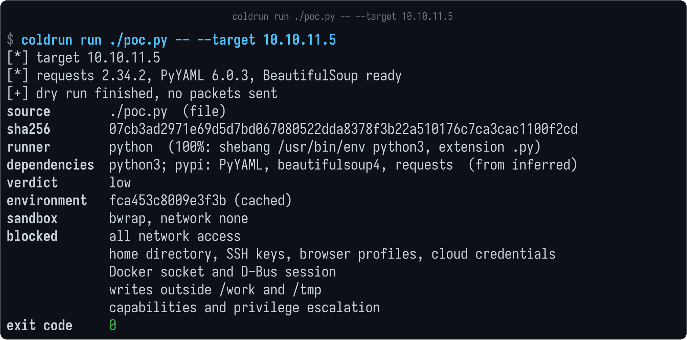
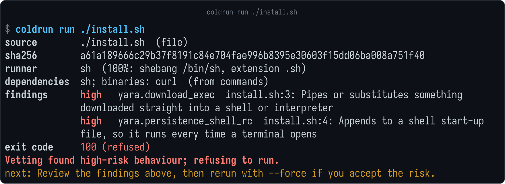
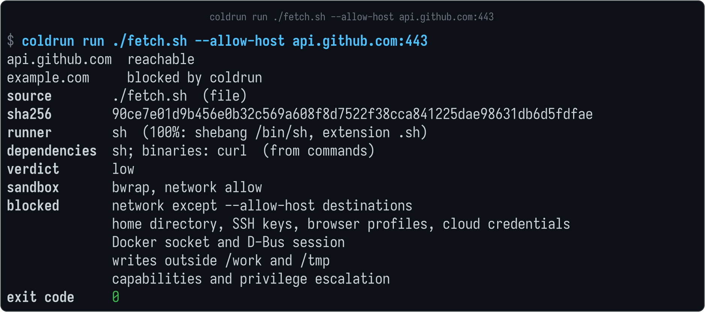
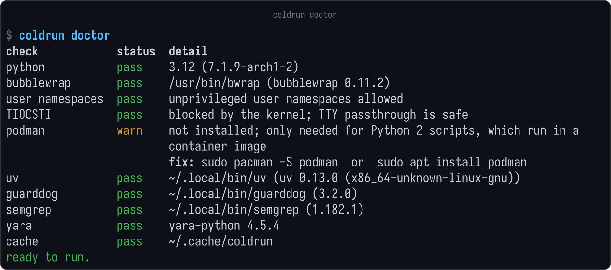

<p align="center">
  
</p>

<h1 align="center">coldrun</h1>

<p align="center">Fetch, vet and sandbox any downloaded script in one command.</p>

<p align="center">
  <a href="https://github.com/rj-karan/coldrun/actions/workflows/ci.yml"></a>
  <a href="https://codecov.io/gh/rj-karan/coldrun"></a>
  <a href="https://pypi.org/project/coldrun/"></a>
  <a href="LICENSE"></a>
</p>

<p align="center">
  <a href="https://zororj.me/coldrun/">Documentation</a> ·
  <a href="#install">Install</a> ·
  <a href="#usage">Usage</a> ·
  <a href="https://zororj.me/coldrun/threat-model/">Threat model</a>
</p>

<p align="center">
  
</p>

You found a script on GitHub, exploit-db or a CTF write-up. The usual loop is:
read it, make a venv, guess the packages, install them on your machine, and
hope it does not read `~/.ssh` on the way. coldrun replaces that loop. It
fetches the script into quarantine, works out what it needs, installs that
inside a bubblewrap sandbox, and runs it there: no network unless you say so,
no home directory, no credentials, nothing written outside `/work`.

The script above has three third-party imports and no requirements file.
coldrun found them, installed them inside the sandbox on the first run, and
reuses that environment on every run after, like this one.

```
coldrun run https://github.com/someone/tool/blob/main/script.py -- --target 10.10.11.5
```

## What it looks like

**It refuses what it should.** A pasted one-line installer pipes a download into
a shell and edits `~/.bashrc`. Vetting stops it before anything runs.

<p align="center">
  
</p>

**Only the hosts you name.** With `--allow-host` the sandbox keeps an empty
network; a proxy on your side connects to the listed hosts and nothing else,
with no DNS for the rest.

<p align="center">
  
</p>

**One check before the first run.** `coldrun doctor` checks bubblewrap, user
namespaces, the terminal and the vetting tools, and prints the fix for anything
missing.

<p align="center">
  
</p>

The screenshots are real runs, rendered by `scripts/screenshots.py`.

## Why not just a venv, Docker or firejail

| | venv | Docker | firejail | coldrun |
|---|---|---|---|---|
| Finds and installs the dependencies for you | no | no | no | yes |
| Script cannot read your home directory | no | yes | yes | yes |
| Network off by default | no | no | no | yes |
| No daemon, no image to build, no root | yes | no | yes | yes |
| Works on a script you have not read yet | no | no | no | yes |

## Install

```
uv tool install 'coldrun[vet]'   # coldrun with the YARA script rules
uv tool install semgrep guarddog # Python script rules and dependency vetting
uvx coldrun --version            # or run without installing (no vetting)
```

On Arch and Omarchy, every release also carries a pacman package:

```
curl -LO https://github.com/rj-karan/coldrun/releases/latest/download/coldrun.pkg.tar.zst
sudo pacman -U coldrun.pkg.tar.zst   # pulls bubblewrap, uv and the Python libraries from the repos
```

It installs the man page and bash, zsh and fish completions. `sudo pacman -S python-yara`
adds the YARA script rules. The PKGBUILD is in `packaging/aur/` for building it yourself.

Needs Linux, Python 3.10+ and [bubblewrap](https://github.com/containers/bubblewrap)
from your distribution (`pacman -S`, `apt install`, `dnf install`, `zypper install` or
`apk add` bubblewrap). `coldrun doctor` checks the rest and gives your distribution's
command for anything missing.

Tested in CI on Arch, Fedora, Debian 12, Ubuntu 22.04 and 24.04, Rocky 8 and 9,
openSUSE Tumbleweed and Alpine, on x86_64 and arm64. NixOS is not supported yet: its
programs live in `/nix/store`, which the sandbox does not mount.

## Usage

```
coldrun run SOURCE [flags] [-- script args]   # fetch, detect, vet, sandbox, run
coldrun scan SOURCE                           # vet only: findings and verdict, exit 100 on high
coldrun deps SOURCE                           # print resolved dependencies, run nothing
coldrun doctor                                # check bwrap, user namespaces, uv, vetting tools
coldrun cache list | clean                    # cached dependency environments
```

`SOURCE` is a local path, an `http(s)` URL, a GitHub repo, `tree` or `blob` URL, a
gist URL, or `edb:ID` for exploit-db. A tar or zip
is extracted with traversal and link checks and the one script at its top runs with
its siblings visible read-only under `/work/src`. Everything after `--` is passed to
the script untouched.

| Flag | Default | Meaning |
|---|---|---|
| `--net none\|allow\|full` | `none` | Network policy inside the sandbox |
| `--allow-host HOST[:PORT]` | none | Permit one destination; repeatable; implies `--net allow`. The sandbox keeps an empty network namespace and reaches the host through a proxy that connects only to the list, so there is no DNS for anything else. Clients must honour `https_proxy` (curl, wget, requests, uv do; raw sockets need `--net full`) |
| `--listen [ADDR:]PORT` | none | Forward one port into the sandbox for callbacks and reverse shells; repeatable. The host side binds `127.0.0.1` unless you give an address: use your VPN address (or `0.0.0.0`) so a target can reach it. The script listens on `127.0.0.1:PORT` inside; the rest of the network stays closed |
| `--rw PATH` | none | Mount one host path read-write; repeatable. `/`, `$HOME` and credential directories are refused |
| `--out DIR` | `./coldrun-out` | Where files the script writes in `/work` are copied on exit |
| `--backend bwrap\|podman` | auto | Force a sandbox backend; runners that ship an image use Podman, the rest bubblewrap |
| `--lang NAME` | auto | Override type detection |
| `--yes` | off | Skip the confirmation on medium risk |
| `--force` | off | Run despite a high-risk verdict; prints a warning |
| `--json` | off | One JSON document on stdout; human output and the script's stdout go to stderr |

### What the sandbox guarantees

No `$HOME`, SSH keys, browser profiles, cloud credentials, Docker socket or D-Bus
session. New user, PID, mount, IPC, UTS and network namespaces; no capabilities;
`no_new_privs`. Read-only root, private `/tmp`, the script read-only in `/work`.
Network off unless you ask. Environment scrubbed to an allowlist.

### JSON output

`--json` on `run`, `scan` and `deps` prints one document on stdout and moves the
human report, and the script's own output, to stderr. The fields are described in
[docs/report.schema.json](docs/report.schema.json); `schema_version` is 1.

```
coldrun scan tool.py --json | jq '.verdict, [.findings[].rule_id]'
```

### Exit codes

The script's own exit code, except `100` (refused by vetting), `101` (sandbox could
not be set up; run `coldrun doctor`) and `102` (dependency resolution failed).

### Runners

| Runner | Dependencies from | Installed with |
|---|---|---|
| Python 3 | PEP 723 block, `requirements.txt` beside the script, else imports parsed with `ast` | uv, once per dependency set, cached under `~/.cache/coldrun/envs` |
| Python 2 | Same as Python 3, imports read line by line | The image's pip in a pinned Python 2.7 image on Podman, registry-only network |
| Bash / sh | Commands the script invokes | Nothing; missing tools are reported with the `pacman` or `apt` line |
| Node | `package.json` beside the script, else `require` and `import` statements | The system `npm` with `--ignore-scripts`, registry-only network |
| Go | `go.mod` beside the script, else third-party imports | The system `go get` through `proxy.golang.org` only; built offline |
| Ruby | `Gemfile` beside the script, else `require` lines that are not the standard library | The system `gem install` from rubygems.org only |

## Status

v1.0 completes every milestone of the [spec](docs/SPEC.md). Python 3, Python 2,
Bash, Node, Go and Ruby scripts run sandboxed with their dependencies resolved,
on bubblewrap or, for runners that ship an image, rootless Podman. The script, its
dependencies and its GitHub source are vetted first. Network access can be limited
to named hosts with `--allow-host`, callbacks arrive through `--listen`, and scripts
can come from archives, GitHub repositories, gists and exploit-db.

## Contributing

Issues and pull requests are welcome; see [CONTRIBUTING.md](CONTRIBUTING.md).
If coldrun saves you a venv-and-pray cycle, a star helps the next person find it.

## Licence

MIT. See [LICENSE](LICENSE).
