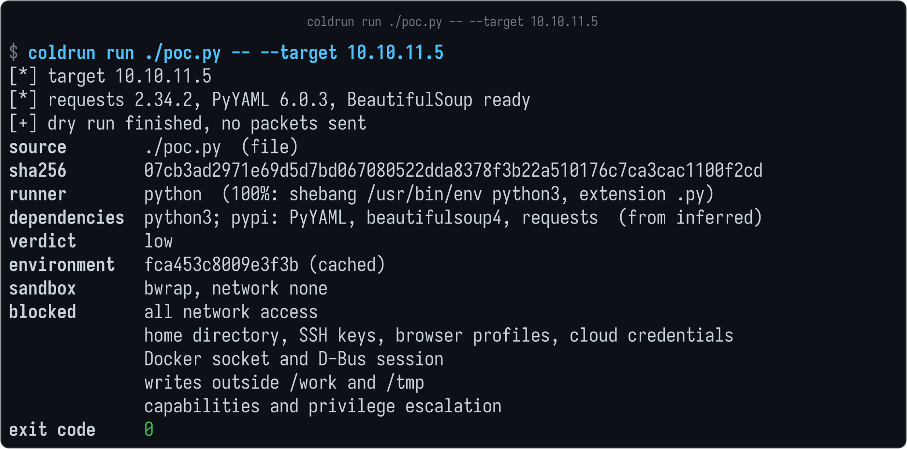
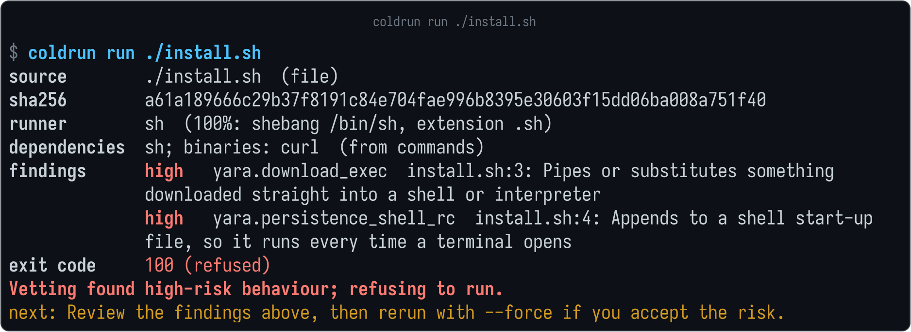

# coldrun

Fetch, vet and sandbox any downloaded script in one command.

You found a proof of concept on GitHub, a tool in a gist, or an exploit on
exploit-db. Running it means reading it, making a venv, guessing the packages,
installing them on your machine, and hoping. coldrun fetches the script into
quarantine, works out what it needs, vets the script and its dependencies, and
runs it in a sandbox with no network, no home directory and a read-only root
unless you allow more.

**The sandbox is the protection; the scan is the warning.** coldrun stays safe
even when the scan says clean.

## Install

```sh
uv tool install 'coldrun[vet]'   # coldrun with the YARA script rules
uv tool install semgrep guarddog # Python script rules and dependency vetting
coldrun doctor                   # checks bubblewrap, user namespaces and the rest
```

On Arch and Omarchy, every release also carries a pacman package:

```sh
curl -LO https://github.com/rj-karan/coldrun/releases/latest/download/coldrun.pkg.tar.zst
sudo pacman -U coldrun.pkg.tar.zst
```

Linux only. Needs Python 3.10 or newer and
[bubblewrap](https://github.com/containers/bubblewrap): `pacman -S bubblewrap`
on Arch and Omarchy, `apt install bubblewrap` on Debian, Kali and Ubuntu.
Podman is needed only for Python 2 scripts.

## A first run



The script has three third-party imports and no requirements file. coldrun
found them, installed them inside the sandbox on the first run, and reuses that
environment on every run after, like this one.

And when a script should not run at all:



## Where to go next

- [Usage](usage.md): every command, flag and source form, with examples.
- [Threat model](threat-model.md): what the sandbox guarantees and what it does not.
- [Runners](runners.md): the languages coldrun runs and how to add one.
- [JSON report](json.md): the `--json` document for scripts and CI.
